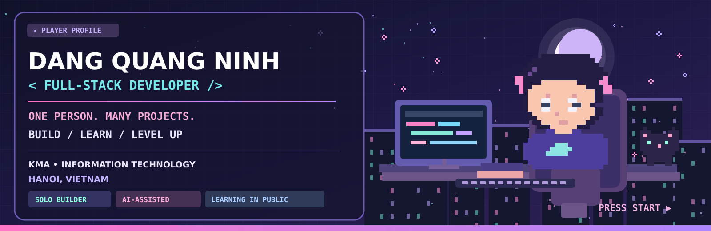
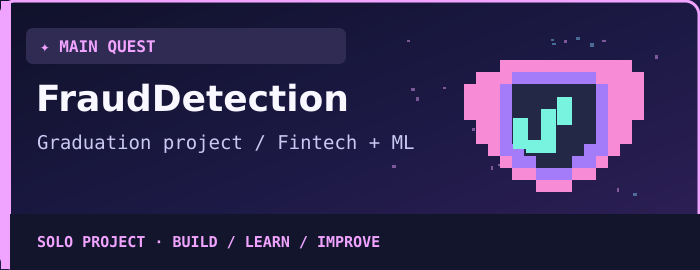
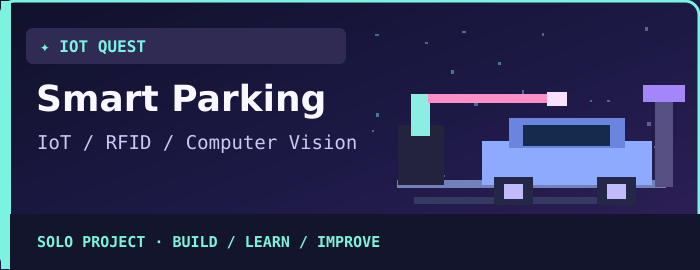
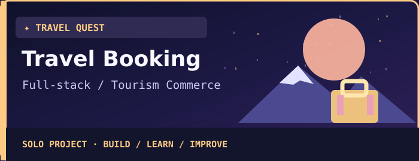
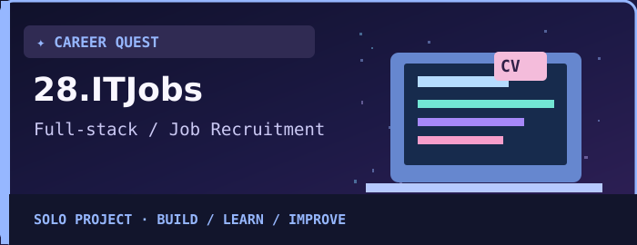
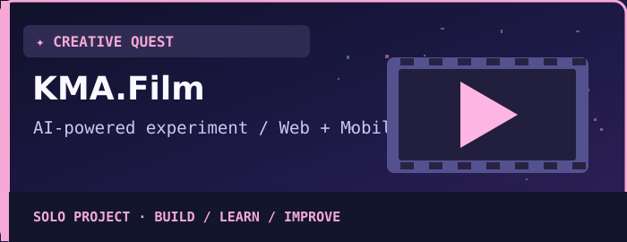

<!-- Profile README for github.com/quangninh0212 | Anime / Pixel Edition -->
<div align="center">
  
  <br /><br />
  
  <br /><br />
  <a href="mailto:dangninh138@gmail.com"></a>
  <a href="https://www.facebook.com/quangninh2109/"></a>
  <a href="https://github.com/quangninh0212"></a>
  <br /><br />
  
  
</div>

---

## 🕹️ Player Info — About Me

```typescript
const developer = {
  name: "Đặng Quang Ninh",
  username: "quangninh0212",
  role: "Aspiring Full-stack Developer",
  school: "Vietnam Academy of Cryptography Techniques (KMA)",
  major: "Information Technology",
  location: "Hanoi, Vietnam",
  favoriteStack: ["Node.js", "Express.js", "Next.js", "React", "TypeScript"],
  sideQuests: ["Web Apps", "IoT", "Computer Vision", "Applied ML"],
  devMode: "Solo projects + continuous learning + AI assistance",
  motto: "Build → Understand → Improve → Repeat",
};
```

I'm **Đặng Quang Ninh**, an Information Technology student at **Vietnam Academy of Cryptography Techniques (KMA)** in Hanoi, Vietnam. I'm pursuing **full-stack development**, especially applications built with **Node.js / Express.js, Next.js / React, TypeScript and Tailwind CSS**.

My repositories are a mix of **course-based practice, personal projects and experiments**. I build projects independently, enjoy learning by doing, and use AI tools as part of my workflow. My current priority is to strengthen my understanding of **software architecture, backend systems, debugging and the technical decisions behind my graduation project**.

> 🌸 **Currently leveling up:** from shipping features to clearly explaining, testing and maintaining the code behind them.

## 🎓 Academic Achievements — Unlocked

<div align="center">
  
  
  
  
</div>

- 🏫 **University:** Vietnam Academy of Cryptography Techniques (KMA)
- 📚 **Major:** Information Technology
- 🏅 **5 academic encouragement scholarships:** 3 *Excellent*-level and 2 *Good*-level awards, reflecting both academic performance and conduct assessment.

## 🧰 Inventory — Tech Stack

<div align="center">
  <b>💖 Main web stack</b><br /><br />
  
  <br /><br />
  <b>🧪 Used in projects / currently exploring</b><br /><br />
  
</div>

<details>
<summary><b>📜 Expand tech inventory</b></summary>

| Category | Technologies |
| :--- | :--- |
| Primary learning focus | JavaScript, TypeScript, Node.js, Express.js, React, Next.js, Tailwind CSS |
| Backend & databases | REST APIs, MongoDB / Mongoose, PostgreSQL, SQLite |
| Project integrations | JWT, Cloudinary, VNPay & ZaloPay sandbox, SMTP / OTP |
| IoT & computer vision | ESP32, FreeRTOS, RFID, Arduino C++, Flask, OpenCV, EasyOCR |
| Other project technologies | Python, FastAPI, Java, Unity / C#, Pug templates |
| Tools | Git, GitHub, Docker, VS Code, Codex / AI coding tools |

*Project exposure is not the same as professional proficiency. My primary focus is the full-stack JavaScript / TypeScript ecosystem.*
</details>

## 🗺️ Quest Board — Featured Projects

<table>
  <tr>
    <td width="50%" valign="top">
      <a href="https://github.com/quangninh0212/FraudDetection"></a>
      <h3>🛡️ <a href="https://github.com/quangninh0212/FraudDetection">FraudDetection</a></h3>
      <b>Graduation Project · In Progress</b>
      <p>A single-bank transaction fraud and AML detection system, exploring ML-powered risk scoring, analyst workflows, role-based permissions and auditing.</p>
      <p><code>Next.js</code> <code>TypeScript</code> <code>Node.js</code> <code>FastAPI</code> <code>PostgreSQL</code></p>
      <sub>Built with extensive Codex assistance; I'm actively studying the system to explain and defend the technical design.</sub>
    </td>
    <td width="50%" valign="top">
      <a href="https://github.com/quangninh0212/smart-parking"></a>
      <h3>🚗 <a href="https://github.com/quangninh0212/smart-parking">Smart Parking</a></h3>
      <b>IoT + Computer Vision · Personal Project</b>
      <p>Parking system prototype connecting ESP32/FreeRTOS, RFID, barrier control, camera-based license plate recognition and a Flask dashboard for parking sessions and fees.</p>
      <p><code>ESP32</code> <code>C++</code> <code>FreeRTOS</code> <code>Python</code> <code>Flask</code> <code>OpenCV</code> <code>SQLite</code></p>
      <sub>AI-assisted project that I've worked to understand, particularly how the hardware and software interact.</sub>
    </td>
  </tr>
  <tr>
    <td width="50%" valign="top">
      
      <h3>🧳 Travel & Tour Booking</h3>
      <b>Course-based Personal Project · Source Not Yet Published</b>
      <p>Tour discovery and booking application with cart, customer and administrator interfaces, permissions, revenue dashboards and sandbox payment integrations.</p>
      <p><code>Node.js</code> <code>Express</code> <code>Pug</code> <code>MongoDB</code> <code>VNPay</code> <code>ZaloPay</code></p>
      <sub>Built individually while learning through an online course and coding practice.</sub>
    </td>
    <td width="50%" valign="top">
      
      <h3>💼 28.ITJobs</h3>
      <b>Course-based Personal Project · Source Not Yet Published</b>
      <p>A recruiting platform connecting job seekers and companies, with job search, application tracking, CV uploads and employer job-management tools.</p>
      <p><code>Next.js</code> <code>TypeScript</code> <code>React</code> <code>Express</code> <code>MongoDB</code></p>
      <sub>Built individually as part of learning and practicing full-stack development.</sub>
    </td>
  </tr>
</table>

### 🎬 Creative Side Quest — KMA.Film

<table><tr>
  <td width="40%" valign="middle"></td>
  <td valign="middle"><b>KMA.Film — AI-Driven Product Experiment</b><br /><br />A movie website and mobile app exploring content browsing, streaming, watchlists, activation and administration workflows.<br /><br /><code>Next.js</code> <code>React Native</code> <code>Node.js</code> <code>PostgreSQL</code><br /><br /><sub>Primarily vibe-coded with AI from start to finish. I treat it as a product experiment, not proof of deep expertise in every implementation detail.</sub></td>
</tr></table>

## 🎮 Side Quests — Learning Projects

| Project | What I practiced | Repository |
| :--- | :--- | :--- |
| 🎵 Music Web | Music listening web app | [View code](https://github.com/quangninh0212/music-web) |
| 📦 Product Management | Web-based product management | [View code](https://github.com/quangninh0212/product-management) |
| ✅ Task Management | Backend and task management | [View code](https://github.com/quangninh0212/task-management) |
| 📚 LibraryKMA | Java library management | [View code](https://github.com/quangninh0212/LibraryKMA) |

<details>
<summary><b>🕹️ Bonus levels — University game assignments</b></summary>

- 🎲 [2D Top-Down RPG](https://github.com/quangninh0212/2D-Top-Down-RPG) — Unity / C# assignment.
- 🏎️ [Car Parking Game](https://github.com/quangninh0212/CarParkingGame) — Unity / C# assignment.

Both were primarily **vibe-coded with AI**, for coursework and experimentation. Game development is not my area of expertise.
</details>

<details>
<summary><b>🤖 Behind the scenes — How I use AI</b></summary>

All projects featured here are **solo projects**, though many are based on online courses or use AI coding assistance.

- **FraudDetection:** CodeX/Codex-assisted implementation; studying the codebase, design, testing and tradeoffs for my graduation defense.
- **Smart Parking:** AI-supported implementation; I understand the overall hardware–software workflow and study the code.
- **KMA.Film and both Unity game assignments:** largely vibe-coded with AI, without claiming comprehensive knowledge of their source code.
- **Other learning projects:** built while following online lessons and practicing through hands-on coding.

I believe honest learning progress matters more than inflated titles or tech-stack lists.
</details>

## 📊 Game Stats — GitHub Activity

<div align="center">
  
  
  <br />
  
</div>

<details>
<summary><b>🐍 View contribution snake</b></summary>

<div align="center">
  <picture>
    <source media="(prefers-color-scheme: dark)" srcset="https://raw.githubusercontent.com/quangninh0212/quangninh0212/output/github-contribution-grid-snake-dark.svg" />
    <source media="(prefers-color-scheme: light)" srcset="https://raw.githubusercontent.com/quangninh0212/quangninh0212/output/github-contribution-grid-snake.svg" />
    
  </picture>
</div>

*The snake appears after the GitHub Actions workflow runs successfully for the first time.*
</details>

---

<div align="center">
  <h3>🌸 Thanks for visiting my little corner of GitHub!</h3>
  <p>✦ <b>One developer, many quests, always learning.</b> ✦</p>
  <a href="mailto:dangninh138@gmail.com"></a>
  <a href="https://github.com/quangninh0212?tab=repositories"></a>
</div>
